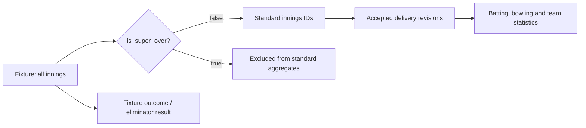

# Issue #104 super-over aggregate implementation

## Export provenance and scope

Imported from original local Codex session logs on 2026-10-11. This is a
conversation export, not a reconstructed summary. User and assistant messages
are retained in log order with their original UTC timestamps. Tool calls, tool
results, system/developer instructions, internal reasoning, and binary or linked
attachments are not included. Environment and browser-state metadata are omitted.
Compaction summaries are identified separately; session logs can contain inherited
messages, and a resumed session may overlap an earlier session. The original logs
remain private. Visible redaction markers remove credentials, email addresses,
and personal folder names. Verification statements are preserved as historical
statements and do not claim that checks were rerun during this import.


## Session 01a005f4-d4e2-7683-b219-841dde1bb6ff

Logged model identifiers: gpt-5.6-sol.


### User — 2026-08-15T15:05:30.185Z

I want to investigate and complete Gitea Issue #104 in this repository:

Repository:
C:\Uni\Semester_2\SDP\Project\Sport-Analytics-Tool

Issue:
#104 — Exclude super-over innings from batting and bowling aggregates

Issue objective:
Super-over performances are tie-breaker performances and must not be included in standard batting or bowling statistics. Innings are identified by `innings.is_super_over`. Standard fixture, season, competition, and career aggregates should exclude rows where `is_super_over = true`.

Acceptance criteria discussed:

1. Every batting and bowling aggregate excludes `is_super_over = true`.
2. The exclusion is centralised rather than repeated independently throughout aggregate queries.
3. There is a test using a fixture containing a super over and values checked against a published scorecard.
4. The exclusion rule is documented.
5. Legitimate cases where super-over statistics may be included are explicitly named and separately scoped.

Important discovery:
This is not a greenfield implementation. Much of #104 appears to have been implemented incidentally by Dean Feldman in commit:

5bb121f feat(statistics): derive fixture cricket statistics

Existing implementation:

- `apps/backend/src/modules/statistics/fixture-statistics.repository.ts`
  - Around line 57, the innings query contains:
    `AND i.is_super_over = false`
  - Around line 97, the accepted-delivery query contains:
    `AND accepted_innings.is_super_over = false`
- `apps/backend/src/modules/statistics/fixture-statistics.derivation.ts`
  - The response reports `superOversIncluded: false`.
  - It emits `NO_STANDARD_INNINGS` when no non-super-over innings are available.
- `packages/contracts/src/public-read.ts`
  - The response contract requires `superOversIncluded` to be the literal value `false`.
- `docs/statistics/fixture-statistics.md`
  - Already states that standard fixture statistics exclude innings marked `is_super_over`.
- `docs/database/schema.md` and
  `docs/requirements/sport-domain-definition.md`
  - Also describe exclusion of super overs from standard aggregates.
- `database/seeds/matches/423788.json`
  - Contains a representative match with two normal innings and two super-over innings.
- `database/seeds/README.md`
  - Identifies fixture 423788 as the super-over reference fixture.
- `apps/backend/scripts/queries/c3-super-over.sql`
  - Contains an existing diagnostic super-over query.

Current test coverage:

- `apps/backend/tests/unit/fixture-statistics.repository.test.ts`
  - Tests accepted revisions and event ordering.
  - It does not appear to prove, using real database records, that super-over rows are excluded.
- `apps/backend/tests/api/fixture-statistics.test.ts`
  - Uses a mocked service response containing `superOversIncluded: false`.
- `packages/contracts/src/tests/public-read.test.ts`
  - Tests the response contract.
- There does not appear to be a database integration test that loads fixture 423788, derives its statistics, and proves that its super-over runs, balls, and wickets are absent.

Likely remaining work:

1. First inspect the current branch, latest `main`, live Issue #104, and all aggregate entry points. Do not assume the earlier audit is complete.
2. Confirm whether fixture statistics are currently the only implemented batting/bowling aggregates. Season and career aggregates appear to be planned but not implemented.
3. Determine whether the two SQL predicates count as sufficiently centralised. They are both in the statistics repository, but the predicate itself is repeated.
4. Prefer a single standard-innings data boundary that all derivations consume. Avoid an unnecessary database view or migration unless justified.
5. Add a real PostgreSQL integration test using fixture 423788.
6. Establish expected normal-innings batting and bowling figures using an authoritative published scorecard.
7. Prove that including the super-over events would change at least one batting or bowling figure, and that the actual standard result excludes that difference.
8. Add or tighten documentation explaining:
   - standard aggregates exclude super overs;
   - separately requested super-over-only statistics are a legitimate future inclusion case;
   - an explicitly named combined scope could include them in future, but must never be the default;
   - match outcome/eliminator information may still reference a super over even though player aggregates exclude its deliveries.
9. Add an evidence record if that matches repository conventions.
10. Update the appropriate AI-assistance register if required by repository policy.

Before editing:
- Read `AGENTS.md` completely and follow repository instructions.
- Run `git status` and preserve all existing work.
- The previous work was on `graz/86-supabase-auth-audit`, with separate PRs for #86 and #43. Do not base #104 on either unmerged feature branch.
- Start #104 from the latest clean `main`, for example:
  - `git fetch origin`
  - `git switch main`
  - `git pull --ff-only origin main`
  - `git switch -c graz/104-exclude-super-over-aggregates`
- If the working tree is not clean, stop and explain before switching branches.

Ownership caution:
At the last check, #104 was unassigned and had no comments, but much of its implementation already exists under another contributor’s commit. Treat this as verification/completion work and do not claim the pre-existing implementation as new work. Before substantial changes, recommend an issue comment explaining what already exists and what validation remains.

Testing:
Use the local Docker PostgreSQL test database, never the shared Supabase database. Relevant command:

npm run test:database --workspace=@sport-analytics/backend

Also run the focused statistics unit/API tests, backend typecheck, lint, formatting checks, and any required repository checks.

Known limitation:
Repository CI is currently unavailable and is expected to be repaired separately by the lecturer, so record complete local validation.

Complexity assessment:
This is approximately 4/10 complexity: low code complexity but medium test/evidence complexity. It should be treated as a small-to-medium verification and completion issue, probably several hours rather than a multi-day feature.

Please begin with a read-only gap analysis. Show exactly which #104 acceptance criteria are already satisfied, partially satisfied, or missing before modifying anything.


### Assistant — 2026-08-15T15:05:37.893Z

I’ll keep this first pass strictly read-only. I’ll verify the worktree before any branch operation, inspect the repository guidance and exported tracker context, trace every implemented batting/bowling aggregate entry point, and then map concrete evidence to each acceptance criterion. I will not fetch, switch branches, comment on the issue, or edit files during this gap analysis.


### Assistant — 2026-08-15T15:05:53.164Z

The worktree is clean, on `main`, and matches the locally known `origin/main`; that makes the requested audit safe. I have not yet established that this is the latest remote commit, because doing so requires a network read. The generated Gitea context export is absent, so I’ll query the public issue/remote state without changing local refs, then continue with the code trace.


### Assistant — 2026-08-15T15:06:46.678Z

Remote `main` is confirmed current at `4694ccc`; the checkout is exactly at that commit. The live issue is not publicly readable from this environment—the Gitea API and HTML route both return “not found,” consistent with a private/authenticated tracker—and I will not request or inspect credentials. I’ll therefore distinguish live-tracker facts that cannot be independently verified from the code-and-history conclusions that can.


### Assistant — 2026-08-15T15:07:41.249Z

The implementation trace shows only one production aggregate family today: the fixture-statistics route/service/repository/derivation path. Season and career aggregates exist only as documented future requirements, so #104’s executable scope is currently fixture statistics. The fixture boundary filters both innings metadata and accepted deliveries, but it repeats the predicate in two SQL statements; that is the key centralization gap to assess.


### Assistant — 2026-08-15T15:08:58.988Z

The seed is a strong oracle candidate: its two standard innings are 214/6 and 214/4, followed by super overs of 6/1 and 9/0. It also gives clear “would fail if included” deltas—for example, Brendon McCullum changes from 116 off 56 to 118 off 57, while Tim Southee changes from 0/44 in 4 overs to 1/50 in 5 overs if the super over is folded in. Published reports independently confirm the standard 116(56), Southee 0/44, the tied 214 totals, and Australia’s 1/6 super over.


### Assistant — 2026-08-15T15:10:18.705Z

The audit is complete. No current test executes the repository against PostgreSQL with `423788`, no test asserts either SQL super-over predicate, and the contract/API tests only validate a mocked `false` scope flag. Documentation establishes the default exclusion and names super-over-only statistics, but it still calls the convention client-unconfirmed and does not explicitly name a future combined scope or explain that eliminator/outcome data remains valid.


### Assistant — 2026-08-15T15:11:19.657Z

## Read-only gap analysis

The repository is unchanged and clean on `main`. Local `main`, local `origin/main`, and remote `main` all resolve to `4694ccc9d83334b8d353a2ede007b1b9956cc30b`.

Live Issue #104 could not be independently inspected because Gitea returned “not found” without authenticated tracker access. I did not request credentials or modify local refs.

### Acceptance criteria

| # | Status | Finding |
|---|---|---|
| 1. Every batting/bowling aggregate excludes super overs | **Satisfied for the currently implemented scope** | Fixture statistics are the only production batting/bowling aggregates. Both innings and accepted deliveries are filtered before the shared batting/bowling derivation runs. Season, competition, and career aggregates are documented but not implemented. |
| 2. Exclusion is centralised | **Partially satisfied** | All derivations consume one repository loader, which is a good architectural boundary. However, `is_super_over = false` is independently repeated in two SQL statements, leaving a maintenance/drift risk. |
| 3. PostgreSQL test using a published super-over fixture | **Missing** | No database statistics test exists. Repository tests mock query results, and API/contract tests only use a mocked `superOversIncluded: false`. |
| 4. Exclusion rule is documented | **Partially satisfied** | Several documents state the exclusion, but some still call the convention client-unconfirmed. The documentation is therefore explicit but internally unresolved. |
| 5. Legitimate inclusion scopes are separately named | **Partially satisfied** | Super-over-only statistics are named as a separate future scope. A future explicitly combined scope and the distinction between player aggregates and match outcome/eliminator data are not documented. |

### Existing implementation and attribution

The relevant behavior was introduced by Dean Feldman in `5bb121f` for Issue #52:

- Standard innings are excluded at [fixture-statistics.repository.ts](C:/Uni/Semester_2/SDP/Project/Sport-Analytics-Tool/apps/backend/src/modules/statistics/fixture-statistics.repository.ts:55).
- Accepted deliveries repeat the exclusion at [fixture-statistics.repository.ts](C:/Uni/Semester_2/SDP/Project/Sport-Analytics-Tool/apps/backend/src/modules/statistics/fixture-statistics.repository.ts:88).
- Batting and bowling both consume that filtered event collection at [fixture-statistics.derivation.ts](C:/Uni/Semester_2/SDP/Project/Sport-Analytics-Tool/apps/backend/src/modules/statistics/fixture-statistics.derivation.ts:232).
- `NO_STANDARD_INNINGS` is emitted at [fixture-statistics.derivation.ts](C:/Uni/Semester_2/SDP/Project/Sport-Analytics-Tool/apps/backend/src/modules/statistics/fixture-statistics.derivation.ts:178).
- The response always reports `superOversIncluded: false` at [fixture-statistics.derivation.ts](C:/Uni/Semester_2/SDP/Project/Sport-Analytics-Tool/apps/backend/src/modules/statistics/fixture-statistics.derivation.ts:322).
- The public contract enforces literal `false` at [public-read.ts](C:/Uni/Semester_2/SDP/Project/Sport-Analytics-Tool/packages/contracts/src/public-read.ts:150).

No season, competition, or career statistics repository/service/route currently exists. Those scopes appear only in the requirement catalogue at [sport-domain-definition.md](C:/Uni/Semester_2/SDP/Project/Sport-Analytics-Tool/docs/requirements/sport-domain-definition.md:160).

### Centralization conclusion

The current loader is centralized at the module level, but not at the policy-expression level. I recommend selecting the standard innings once in the first query, then passing those innings IDs into the accepted-delivery query. That would leave only one `is_super_over = false` predicate while preserving the existing repository boundary and avoiding a database view or migration.

A mere shared SQL string constant would remove textual duplication but would not create as strong a data boundary.

### Missing test evidence

The existing repository test at [fixture-statistics.repository.test.ts](C:/Uni/Semester_2/SDP/Project/Sport-Analytics-Tool/apps/backend/tests/unit/fixture-statistics.repository.test.ts:6):

- mocks both database responses;
- checks accepted-submission predicates and ordering;
- does not assert either super-over predicate;
- cannot prove database-level exclusion.

The API test at [fixture-statistics.test.ts](C:/Uni/Semester_2/SDP/Project/Sport-Analytics-Tool/apps/backend/tests/api/fixture-statistics.test.ts:22) also mocks the service response.

Fixture `423788` is an excellent integration oracle. The committed seed contains:

- New Zealand standard innings: 214/6
- Australia standard innings: 214/4
- Australia super over: 6/1
- New Zealand super over: 9/0

Published reports confirm the tied 214 totals, Brendon McCullum’s standard 116 from 56 balls, and the separate super-over result. [New Zealand Cricket’s report](https://www.nzc.nz/match-reports/archive/mccullum-southee-steer-blackcaps-to-super-win/) records the standard figures and super-over sequence; [ABC’s report](https://www.abc.net.au/news/2010-02-28/black-caps-win-super-over-thriller/345746) records Southee’s standard 0/44 and Australia’s 1/6 super over.

Useful failure-sensitive assertions derived from the committed seed are:

| Player | Correct standard figure | Incorrect if combined |
|---|---:|---:|
| Brendon McCullum | 116 runs, 56 balls | 118 runs, 57 balls |
| Tim Southee | 44 conceded, 24 legal balls, 0 wickets | 50 conceded, 30 legal balls, 1 wicket |
| Shaun Tait | 40 conceded, 24 legal balls, 2 wickets | 49 conceded, 27 legal balls, 2 wickets |

These seed-derived deltas have not yet been proven through PostgreSQL and the production repository/derivation path—that is the principal missing acceptance test.

The test-database seed script currently only updates `database_health`; it does not ingest `423788`. Safe integration-test fixture loading will therefore need to be added or existing ingestion logic made reusable against `DATABASE_URL_TEST`.

### Documentation gaps

Already documented:

- Fixture exclusion: [fixture-statistics.md](C:/Uni/Semester_2/SDP/Project/Sport-Analytics-Tool/docs/statistics/fixture-statistics.md:17)
- General standard-aggregate rule: [schema.md](C:/Uni/Semester_2/SDP/Project/Sport-Analytics-Tool/docs/database/schema.md:170)
- Separately scoped super-over statistics: [schema.md](C:/Uni/Semester_2/SDP/Project/Sport-Analytics-Tool/docs/database/schema.md:231) and [sport-domain-definition.md](C:/Uni/Semester_2/SDP/Project/Sport-Analytics-Tool/docs/requirements/sport-domain-definition.md:163)

Still needed:

- Remove or reconcile wording that says the convention remains unconfirmed.
- Name `super-over-only` as a separate legitimate scope.
- Reserve an explicit future name such as `standard-and-super-over-combined`; state that it can never be the default.
- Explain that match outcome and `eliminatorCompetitorId` may reference the super over even though its deliveries do not affect standard player aggregates.
- State that future season/competition/career implementations must consume the same standard-innings boundary.

One collateral documentation defect was found: [database/seeds/README.md](C:/Uni/Semester_2/SDP/Project/Sport-Analytics-Tool/database/seeds/README.md:1) contains literal PowerShell here-string wrapper text at its first and last lines. The fixture table is present, but the file is malformed Markdown.

### Completion artifacts

Repository convention supports adding an Issue #104 validation record under `evidence/validation/`. If this analysis is used for implementation, the material AI assistance should also be recorded in the appropriate per-member CSV under `evidence/ai/registers/`.

Before substantive changes, I recommend posting this issue comment:

> Current `main` already excludes super-over innings from fixture statistics through Dean Feldman’s Issue #52 implementation in commit `5bb121f`. I will treat #104 as verification/completion work rather than claim that implementation as new. Remaining work is to consolidate the standard-innings boundary, add a PostgreSQL integration test using fixture 423788 and published scorecard values, document separately scoped inclusion cases and eliminator behavior, and record local validation/evidence.

No branch was created, no tests were run, and no files or tracker state were modified during this audit.


### User — 2026-08-15T15:15:41.799Z

summarise these findings and explain them 


### Assistant — 2026-08-15T15:15:53.420Z

Issue #104 is mostly implemented already, but it is not yet fully proven or documented.

The existing fixture-statistics implementation excludes super-over innings before calculating batting and bowling figures. It also exposes `superOversIncluded: false`, and the contract prevents that value from being changed. Fixture statistics are currently the only implemented batting/bowling aggregates; season, competition, and career aggregates remain future work.

The remaining gaps are:

- The exclusion condition is written twice in the repository’s SQL. Although both checks are in one repository function, they could drift apart. Standard innings should be selected once, with all delivery queries consuming that selection.
- There is no real PostgreSQL test proving the behavior. Existing tests mock the database or service and therefore only check response shape, not actual exclusion.
- Fixture `423788` is suitable for this test. It has two normal innings tied at 214, followed by super overs of 6/1 and 9/0.
- The test should assert figures that would visibly change if the filter failed. For example:
  - Brendon McCullum should remain 116 from 56 balls, not 118 from 57.
  - Tim Southee should remain 0 wickets for 44 runs from 4 overs, not 1 for 50 from 5 overs.
- Documentation already says standard statistics exclude super overs and mentions separately scoped super-over statistics. However, it still contains wording suggesting the rule is awaiting client confirmation.
- Documentation does not yet explicitly describe:
  - a future `super-over-only` scope;
  - a separately named combined scope that must never be the default;
  - that match outcome and eliminator information can still refer to the super over even though player aggregates exclude it.
- An Issue #104 validation record and the appropriate AI-assistance register update will be required when the implementation work is completed.

In acceptance-criteria terms:

- Current fixture batting/bowling exclusion: satisfied.
- Centralized exclusion boundary: partially satisfied.
- PostgreSQL scorecard-backed test: missing.
- Documentation of the default rule: present but needs reconciliation.
- Explicit legitimate inclusion cases: partially documented.

The best completion approach is therefore a small refactor, one strong database integration test using fixture `423788`, targeted documentation updates, and validation evidence. No database migration or view appears necessary. The existing implementation should remain attributed to Dean Feldman’s commit `5bb121f`; Issue #104 should be presented as verification and completion work.


### User — 2026-08-15T15:16:59.366Z

Every batting and bowling aggregate excludes innings where
is_super_over is true
The exclusion is applied in one place rather than repeated per statistic
A test computes an aggregate over a fixture containing a super over and
compares it against the published scorecard figure
The rule is documented in the derivation documentation, with the reason
Any aggregate that legitimately includes super-over data, if one is
identified, is named explicitly rather than filtered by default 
which are completed 


### Assistant — 2026-08-15T15:17:14.084Z

Based on the exact criteria:

| Criterion | Status | Explanation |
|---|---|---|
| Every batting and bowling aggregate excludes `is_super_over = true` | **Completed for implemented aggregates** | Fixture batting and bowling statistics both consume deliveries filtered by `is_super_over = false`. Season and career aggregates do not exist yet. |
| Exclusion is applied in one place | **Partially completed** | Filtering is centralized in the fixture-statistics repository, but the SQL predicate is repeated in two queries. |
| Database test using a super-over fixture and published scorecard | **Not completed** | Fixture `423788` exists, but no PostgreSQL integration test derives and verifies its published figures. |
| Rule and reason documented in derivation documentation | **Partially completed** | The derivation documentation states that super overs are excluded, but does not clearly explain that they are tie-breaker performances rather than standard match innings. |
| Legitimate super-over-inclusive aggregates are explicitly named | **Completed at the design level** | Documentation names separately scoped “super-over statistics.” No implemented aggregate currently includes super-over data by default. |

Therefore, **2 of the 5 criteria are fully completed**, **2 are partially completed**, and **1 is missing**. The main remaining work is centralizing the predicate, adding the real database test, and documenting the reason for the rule.


### User — 2026-08-15T15:17:36.324Z

lets do the work, tell me what to add where


### Assistant — 2026-08-15T15:17:58.330Z

I’ll turn the gap analysis into a concrete change list, including the safest way to load fixture `423788` into the isolated PostgreSQL test database. I’m checking the ingestion and test-database boundaries first so I don’t recommend wiring the test through the development database by accident.


### Assistant — 2026-08-15T15:18:59.411Z

Make the changes in these places.

### 1. Create the branch

After posting the attribution comment on Issue #104:

```powershell
git switch -c graz/104-exclude-super-over-aggregates
```

Current `main` is already clean and matches remote `main`.

### 2. Centralize the exclusion

Edit:

`apps/backend/src/modules/statistics/fixture-statistics.repository.ts`

Keep `i.is_super_over = false` only in the innings query. After constructing `innings`, collect their IDs:

```ts
const standardInningsIds = innings.map((inningsRecord) => inningsRecord.inningsId);
```

Change the delivery query so it consumes those IDs:

```sql
FROM delivery d
JOIN submission source_submission
  ON source_submission.submission_id = d.submission_id
 AND source_submission.status = 'accepted'
WHERE d.innings_id = ANY($1::bigint[])
```

Pass:

```ts
[standardInningsIds]
```

Remove this repeated logic from the delivery query:

```sql
JOIN innings accepted_innings ON accepted_innings.innings_id = d.innings_id
WHERE accepted_innings.fixture_id = $1::bigint
  AND accepted_innings.is_super_over = false
```

This makes the first query the single standard-innings boundary.

### 3. Update the repository unit test

Edit:

`apps/backend/tests/unit/fixture-statistics.repository.test.ts`

Add assertions proving:

```ts
expect(query.mock.calls[0]?.[0]).toContain('i.is_super_over = false');
expect(query.mock.calls[1]?.[0]).toContain('d.innings_id = ANY($1::bigint[])');
expect(query.mock.calls[1]?.[0]).not.toContain('is_super_over');
expect(query.mock.calls[1]?.[1]).toEqual([['11']]);
```

This protects the centralization design, but it does not replace the integration test.

### 4. Make fixture ingestion reusable

The current ingestion script is CLI-only and forces Supabase TLS, so it cannot safely be reused by a local PostgreSQL test.

Extract its database-loading body into:

`apps/backend/scripts/ingest-match-data.ts`

Export something similar to:

```ts
export async function ingestMatchData(
  executor: QueryExecutor,
  matchPath: string,
): Promise<{ fixtureId: string }> {
  // Existing parsing and INSERT logic.
  // Do not connect, BEGIN, COMMIT, ROLLBACK, or close the executor here.
}
```

Then reduce `apps/backend/scripts/ingest-match.ts` to a CLI wrapper that:

1. creates the existing Supabase client;
2. begins a transaction;
3. calls `ingestMatchData`;
4. commits or rolls back;
5. closes the client.

The database test can then provide its own local test client and roll everything back afterward.

### 5. Add the PostgreSQL integration test

Create:

`apps/backend/tests/database/fixture-statistics.database.test.ts`

The test should:

1. Call `assertSafeTestDatabase`.
2. Connect using `DATABASE_URL_TEST`.
3. Start a transaction.
4. Load `database/seeds/matches/423788.json` using `ingestMatchData`.
5. Confirm the database contains four innings, including two with `is_super_over = true`.
6. Call `loadFixtureStatisticsSource(fixtureId, client)`.
7. Call `deriveFixtureStatistics(source)`.
8. Roll back in `afterAll`.

Assert:

```ts
expect(source.innings).toHaveLength(2);
expect(result.scope).toEqual({ superOversIncluded: false });
```

Verify the two standard team totals are both `214`.

Look up players by their stable source references:

```text
BB McCullum: b8a55852
TG Southee:  13c35c9e
```

Assert McCullum’s batting:

```ts
{
  runsScored: 116,
  ballsFaced: 56,
  strikeRate: 207.14,
  fours: 12,
  sixes: 8,
}
```

Assert Southee’s bowling:

```ts
{
  runsConceded: 44,
  legalBallsBowled: 24,
  oversBowled: '4.0',
  economyRate: 11,
  wicketsTaken: 0,
}
```

Also query the excluded super-over records and prove they contain:

- McCullum: another 2 runs from 1 ball;
- Southee: another 6 conceded, 6 legal balls and 1 credited wicket.

That proves a broken filter would produce 118 from 57 and 1/50 from five overs.

### 6. Tighten the derivation documentation

Edit:

`docs/statistics/fixture-statistics.md`

Expand the existing exclusion rule to say:

> Standard fixture batting and bowling statistics exclude innings marked `is_super_over`. A super over is a tie-breaking procedure rather than a standard match innings, so including it would distort ordinary player and team aggregates.

Add a “Super-over scopes” section explaining:

- `standard` excludes super overs and is always the default;
- `super-over-only` is a legitimate future explicit scope;
- `standard-and-super-over-combined` could be introduced as an explicitly named future scope but must never be the default;
- match outcome and eliminator information may still identify the super-over winner;
- season, competition and career statistics must consume the same standard-innings boundary.

Also reconcile the “still to be confirmed” wording in:

- `docs/database/schema.md`
- `docs/requirements/sport-domain-definition.md`

### 7. Add validation evidence

Create:

`evidence/validation/issue-104-super-over-aggregates.md`

Record:

- attribution to the pre-existing `5bb121f` implementation;
- the centralized boundary change;
- fixture `423788`;
- the published scorecard URLs;
- expected standard and excluded figures;
- exact local commands and results;
- the known CI limitation.

Update the appropriate per-member register under:

`evidence/ai/registers/`

### 8. Validate locally

Run:

```powershell
npm run test:database --workspace=@sport-analytics/backend
npm run test:unit --workspace=@sport-analytics/backend
npm run test:api --workspace=@sport-analytics/backend
npm run test --workspace=@sport-analytics/contracts
npm run typecheck --workspace=@sport-analytics/backend
npm run lint --workspace=@sport-analytics/backend
npm run format:check
npm run openapi:lint
```

Do not use the shared Supabase database. The integration test must fail unless `DATABASE_URL_TEST` points to an isolated PostgreSQL database whose name contains `test`.


### User — 2026-08-15T15:25:11.546Z

im in the fixtures-stat.repo.ts and i have found the line : i.is_super_over=false, what do i do next?


### Assistant — 2026-08-15T15:25:24.993Z

Keep that first occurrence—it becomes the single authoritative filter.

Next:

1. After the `const innings = ...flatMap(...)` block, add:

```ts
const standardInningsIds = innings.map((inningsRecord) => inningsRecord.inningsId);
```

2. In the second SQL query, remove:

```sql
JOIN innings accepted_innings
  ON accepted_innings.innings_id = d.innings_id
```

3. Replace:

```sql
WHERE accepted_innings.fixture_id = $1::bigint
  AND accepted_innings.is_super_over = false
```

with:

```sql
WHERE d.innings_id = ANY($1::bigint[])
```

4. At the bottom of that second `executeQuery`, replace:

```ts
[fixtureId],
```

with:

```ts
[standardInningsIds],
```

Leave the later outer join unchanged:

```sql
JOIN innings i ON i.innings_id = d.innings_id
```

Afterward, `is_super_over = false` should appear only once in the file. The second query now receives only the standard innings selected by the first query.


### User — 2026-08-15T15:28:59.888Z

next 


### Assistant — 2026-08-15T15:29:10.349Z

Now update the repository unit test:

Open:

`apps/backend/tests/unit/fixture-statistics.repository.test.ts`

Inside the existing test, after:

```ts
expect(query).toHaveBeenCalledTimes(2);
```

add:

```ts
expect(query.mock.calls[0]?.[0]).toContain('i.is_super_over = false');

expect(query.mock.calls[1]?.[0]).toContain(
  'd.innings_id = ANY($1::bigint[])',
);

expect(query.mock.calls[1]?.[0]).not.toContain('is_super_over');

expect(query.mock.calls[1]?.[1]).toEqual([['11']]);
```

Then run:

```powershell
npm run test:unit --workspace=@sport-analytics/backend
```

This verifies that the exclusion exists once and that the delivery query receives only the selected standard-innings IDs.


### User — 2026-08-15T15:31:04.543Z

18 passed 


### Assistant — 2026-08-15T15:31:15.699Z

Great—the centralized repository change is working.

Next, update:

`docs/statistics/fixture-statistics.md`

Replace the existing rule 4 with:

```md
4. Standard fixture batting, bowling and team aggregates exclude innings marked
   `is_super_over`. A super over is a tie-breaking procedure rather than a standard
   match innings, so including it would distort ordinary player and team statistics.
   The response makes this scope explicit with `superOversIncluded: false`.
```

Then add this section immediately before `## Basic calculations`:

```md
## Super-over scopes

The default `standard` scope excludes all super-over innings.

A future `super-over-only` scope may calculate statistics exclusively from innings
marked `is_super_over`. A future `standard-and-super-over-combined` scope may include
both types, but it must be explicitly named and requested; it must never become the
default.

Fixture outcome information may still identify an eliminator winner even when the
super-over deliveries are excluded from batting and bowling aggregates. Future
season, competition and career aggregates must consume the same standard-innings
boundary.
```

Then run:

```powershell
npx prettier --check docs/statistics/fixture-statistics.md
```


### User — 2026-08-15T15:33:51.226Z

next 


### Assistant — 2026-08-15T15:34:05.056Z

Now remove the stale “unconfirmed” wording.

In `docs/database/schema.md`, replace the super-over decision paragraph with:

```md
5. **Super-over innings** are excluded from standard aggregates. Separately scoped
   `super-over-only` statistics may be provided explicitly. A combined
   `standard-and-super-over-combined` scope may be introduced in future, but it must
   never be the default. The exclusion must eventually become a property of a
   versioned statistic definition.
```

In `docs/requirements/sport-domain-definition.md`, update the “Super-over statistics” table row so its final column no longer says the convention is unconfirmed. Use:

```md
| Super-over statistics | Fixture, participant | Delivery (super-over innings) | Same calculations as standard statistics, but computed using an explicitly requested `super-over-only` scope; excluded from standard aggregates | Intermediate/Advanced |
```

Then go to `## 12. Open stakeholder questions` and remove this question:

```md
1. **Super-over convention:** should super-over statistics be entirely
   excluded from a player's season/career figures, or surfaced as a
   separately labelled scope the client can opt into? Not yet confirmed with
   the client.
```

Renumber the remaining questions from `1` to `4`.

Run:

```powershell
npx prettier --check docs/database/schema.md docs/requirements/sport-domain-definition.md
```


### User — 2026-08-15T15:35:56.322Z

i cant find the super-over decision parageaph in shcema 


### Assistant — 2026-08-15T15:36:03.387Z

In `docs/database/schema.md`, search for this exact text:

```text
Super-over innings
```

There are multiple matches. Use the one under:

```md
## 7. Decisions taken at review
```

It should currently read:

```md
5. **Super-over innings** are excluded from standard aggregates by default, with
   separately scoped statistics available for them. The exclusion must eventually
   be a property of the statistic definition rather than a condition in query
   code. The convention is still to be confirmed with the client.
```

Replace that entire numbered item with:

```md
5. **Super-over innings** are excluded from standard aggregates. Separately scoped
   `super-over-only` statistics may be provided explicitly. A combined
   `standard-and-super-over-combined` scope may be introduced in future, but it must
   never be the default. The exclusion must eventually become a property of a
   versioned statistic definition.
```

It is around line 231 on the current `main` version. Leave the earlier rule 8 around line 170 unchanged.


### User — 2026-08-15T15:40:02.848Z

| Intermediate/Advanced boundary — convention still to be confirmed with the client (open question, §11) | - what does open 1qstion 11 mean?


### Assistant — 2026-08-15T15:40:09.173Z

That text means the super-over rule was previously awaiting confirmation from the client.

The `§11` reference is also incorrect: section 11 is the representative fixture example. The relevant open question is currently in `§12`, “Open stakeholder questions.”

Because Issue #104 now defines the expected rule, replace:

```md
Intermediate/Advanced boundary — convention still to be confirmed with the client (open question, §11)
```

with:

```md
Intermediate/Advanced
```

Then remove the super-over convention question from section 12. This eliminates both the stale uncertainty and the incorrect cross-reference.


### User — 2026-08-15T15:41:33.650Z

i have not asked the client about this decision, but i think its what the team wants to do, is this something i must confirm with the client as a requirement for the sprint and project? 


### Assistant — 2026-08-15T15:41:54.711Z

Yes—you should confirm it with the client before describing it as a stakeholder-approved requirement.

However, client confirmation does not need to block the technical work. The safe approach is:

- Implement and test exclusion as the team’s current default for Issue #104.
- Keep the client-confirmation question open.
- Record clearly that this is a team decision pending stakeholder confirmation.
- Ask the client at the next stakeholder meeting.
- Record their answer in the meeting evidence and Issue #104.

For now, use this table wording:

```md
Intermediate/Advanced — excluded by default under Issue #104; client confirmation pending (§12)
```

In `docs/database/schema.md`, retain:

```md
The convention remains subject to client confirmation.
```

Do not remove the question from section 12 yet.

Ask the client:

> Should standard fixture, season and career batting and bowling statistics exclude super-over performances, while match outcome information may still identify the super-over winner and separately labelled super-over statistics remain possible?

If the client confirms it, update the documentation from “team default pending confirmation” to an approved rule. If they disagree, the implementation scope and Issue #104 acceptance criteria should be revised before closure.


### User — 2026-08-15T15:43:25.725Z

any other places i should add this to what weve changed? 


### Assistant — 2026-08-15T15:43:39.920Z

Yes. Keep the “pending client confirmation” status consistent in these places:

1. `docs/statistics/fixture-statistics.md`

After the explanation of why super overs are excluded, add:

```md
This is the current team-approved default for Issue #104. Client confirmation of
the convention for future season, competition and career aggregates remains pending.
```

In the new scopes section, add:

```md
These scope names describe possible future API behavior; they are not currently
implemented or recorded as client-approved requirements.
```

2. `docs/database/schema.md`

End decision item 5 with:

```md
The current implementation follows this default under Issue #104, while final
client confirmation remains open.
```

3. `docs/requirements/sport-domain-definition.md`

Use this final-column wording:

```md
Intermediate/Advanced — excluded by default under Issue #104; client confirmation pending (§12)
```

Keep the super-over question in section 12.

4. Future validation record

In `evidence/validation/issue-104-super-over-aggregates.md`, include:

```md
## Stakeholder confirmation

The team currently treats super-over exclusion as the default for standard
aggregates under Issue #104. Client confirmation remains pending and must be
recorded in stakeholder-meeting evidence when obtained.
```

5. Issue #104 comment

Mention that implementation can proceed as a team default, but stakeholder confirmation remains outstanding.

Do not add “pending client confirmation” inside the TypeScript code or test names. The implementation should remain unambiguous; the uncertainty belongs in requirements and decision evidence.


### User — 2026-08-15T15:45:43.377Z

## Super-over scopes


These scope names describe possible future API behavior; they are not currently
implemented or recorded as client-approved requirements.

The default `standard` scope excludes all super-over innings.

A future `super-over-only` scope may calculate statistics exclusively from innings
marked `is_super_over`. A future `standard-and-super-over-combined` scope may include
both types, but it must be explicitly named and requested; it must never become the
default.

Fixture outcome information may still identify an eliminator winner even when the
super-over deliveries are excluded from batting and bowling aggregates. Future
season, competition and career aggregates must consume the same standard-innings
boundary.

This is the current team-approved default for Issue #104. Client confirmation of
the convention for future season, competition and career aggregates remains pending.
 this ok?


### Assistant — 2026-08-15T15:45:52.916Z

Almost. Replace “team-approved” because formal team approval has not been confirmed, and avoid implying that `standard` is an implemented API option.

Use:

```md
## Super-over scopes

These scope names describe possible future API behavior; they are not currently
implemented or recorded as client-approved requirements.

The current fixture-statistics response represents standard aggregates and excludes
all super-over innings.

A future `super-over-only` scope may calculate statistics exclusively from innings
marked `is_super_over`. A future `standard-and-super-over-combined` scope may include
both types, but it must be explicitly named and requested; it must never become the
default.

Fixture outcome information may still identify an eliminator winner even when the
super-over deliveries are excluded from batting and bowling aggregates. Future
season, competition and career aggregates must consume the same standard-innings
boundary.

This is the team's current implementation default for Issue #104. Client confirmation
of the convention for future season, competition and career aggregates remains
pending.
```

This accurately distinguishes current behavior, proposed future scopes, and pending client confirmation.


### User — 2026-08-15T15:48:42.509Z

Keep the super-over question in section 12.
Future validation record
In evidence/validation/issue-104-super-over-aggregates.md, include:
## Stakeholder confirmation

The team currently treats super-over exclusion as the default for standard
aggregates under Issue #104. Client confirmation remains pending and must be
recorded in stakeholder-meeting evidence when obtained. - i dont have a file for the issue 104


### Assistant — 2026-08-15T15:48:57.212Z

That is expected—the Issue #104 validation file does not exist yet. Create a new file at:

```text
evidence/validation/issue-104-super-over-aggregates.md
```

Start it with:

```md
# Issue #104 super-over aggregate validation

## Scope and attribution

The standard fixture-statistics implementation was originally introduced by Dean
Feldman in commit `5bb121f` for Issue #52. Issue #104 is verification and completion
work and does not claim the pre-existing implementation as new work.

## Implementation

- Standard innings are selected once using `is_super_over = false`.
- The accepted-delivery query consumes the selected standard-innings identifiers.
- Batting and bowling derivations therefore receive no super-over deliveries.
- The response reports `superOversIncluded: false`.

## Published reference fixture

Fixture `423788` is New Zealand versus Australia on 28 February 2010. The standard
innings were tied at 214 before the match was decided by a super over.

Published references:

- [New Zealand Cricket match report](https://www.nzc.nz/match-reports/archive/mccullum-southee-steer-blackcaps-to-super-win/)
- [ABC News match report](https://www.abc.net.au/news/2010-02-28/black-caps-win-super-over-thriller/345746)

The PostgreSQL integration test and its verified player figures remain to be added.

## Stakeholder confirmation

The team currently treats super-over exclusion as the default for standard
aggregates under Issue #104. Client confirmation remains pending and must be
recorded in stakeholder-meeting evidence when obtained.

## Local validation

- Backend unit tests: 18 passed.
- PostgreSQL integration test: pending.
- Remaining repository checks: pending.

## AI Declaration

This validation record was prepared with the assistance of Codex[GPT-5].
```

Update the “pending” entries after the database test and final checks run. Do not claim that verification passed before it has actually passed.


### User — 2026-08-15T15:49:29.081Z

ok next 


### Assistant — 2026-08-15T15:49:42.267Z

Next, confirm the isolated PostgreSQL test database works before adding the integration test.

From the repository root, run:

```powershell
Test-Path apps/backend/.env.test
docker ps --format "table {{.Names}}\t{{.Status}}\t{{.Ports}}"
npm run test:database --workspace=@sport-analytics/backend
```

Do not display or paste the contents of `.env.test`, because it may contain credentials.

Expected result:

- `Test-Path` returns `True`.
- A local PostgreSQL container is running.
- The existing database tests pass.

If any command fails, paste only the error message. If they pass, the next step is extracting the fixture-ingestion logic so the new test can safely load `423788` into that database.


### User — 2026-08-15T15:50:04.164Z

PS C:\Uni\Semester_2\SDP\Project\Sport-Analytics-Tool> npx prettier --check docs/statistics/fixture-statistics.md
Checking formatting...                                 Test-Path apps/backend/.env.test
>> docker ps --format "table {{.Names}}\t{{.Status}}\t{{.Ports}}"
>> npm run test:database --workspace=@sport-analytics/backend
True
NAMES                           STATUS                 PORTS
sport-analytics-postgres-test   Up 3 hours             0.0.0.0:5433->5432/tcp, [::]:5433->5432/tcp
timeplanner-app-1               Up 4 hours (healthy)   0.0.0.0:3000->3000/tcp, [::]:3000->3000/tcp
timeplanner-postgres-1          Up 4 hours (healthy)   5432/tcp

> @sport-analytics/backend@0.1.0 test:database
> vitest run tests/database


 RUN  v2.1.9 C:/Uni/Semester_2/SDP/Project/Sport-Analytics-Tool/apps/backend

 ❯ tests/database/account-schema.database.test.ts (12)
   ❯ application account authorization schema (12)
     | [ beforeAll ]
     ↓ round-trips the account authorization migration in an isolated schema [skipped]
     ↓ exposes the migrated account, approval, and competition-scope structures [skipped]
     ↓ maps one provider identity to one application account [skipped]
     ↓ keeps identity mapping provider-neutral [skipped]
     ↓ supports approval and revocation without changing authentication identity [skipped]
     ↓ tracks the most recent application-account update [skipped]
     ↓ rejects an unsupported application role [skipped]
     ↓ rejects an unsupported approval state [skipped]
     ↓ prevents duplicate competition grants [skipped]
     ↓ rejects a grant for an unknown account [skipped]
     ↓ rejects a grant for an unknown competition [skipped]
     ↓ removes competition grants when either parent record is removed [skipped]
 ❯ tests/database/submission.database.test.ts (3)
   ❯ direct submission database integration (3)
     / [ beforeAll ]
     ↓ stores a valid submission and its ordered event provenance atomically [skipped]
     ↓ rolls back the submission and earlier events when a later insert conflicts [skipped]
     ↓ rejects a repeated event identifier without storing a partial submission [skipped]
 ❯ tests/database/transaction.database.test.ts (2)
   ❯ database transaction helper (2)
     | [ beforeAll ]
     ↓ commits a successful multi-step transaction [skipped]
     ↓ rolls back all changes when an operation fails [skipped]

⎯⎯⎯⎯⎯⎯⎯⎯⎯⎯⎯⎯⎯⎯⎯⎯⎯⎯⎯⎯⎯⎯⎯⎯⎯⎯⎯⎯⎯⎯⎯⎯⎯⎯⎯⎯⎯⎯⎯⎯⎯⎯⎯⎯⎯⎯⎯⎯⎯⎯⎯⎯⎯⎯⎯ Failed Suites 3 ⎯⎯⎯⎯⎯⎯⎯⎯⎯⎯⎯⎯⎯⎯⎯⎯⎯⎯⎯⎯⎯⎯⎯⎯⎯⎯⎯⎯⎯⎯⎯⎯⎯⎯⎯⎯⎯⎯⎯⎯⎯⎯⎯⎯⎯⎯⎯⎯⎯⎯⎯⎯⎯⎯⎯

 FAIL  tests/database/account-schema.database.test.ts > application account authorization schema
Error: DATABASE_URL_TEST is required.
 ❯ Module.assertSafeTestDatabase scripts/test-database-safety.ts:11:11
      9| 
     10|   if (!testDatabaseUrl) {
     11|     throw new Error('DATABASE_URL_TEST is required.');
       |           ^
     12|   }
     13| 
 ❯ tests/database/account-schema.database.test.ts:55:25

⎯⎯⎯⎯⎯⎯⎯⎯⎯⎯⎯⎯⎯⎯⎯⎯⎯⎯⎯⎯⎯⎯⎯⎯⎯⎯⎯⎯⎯⎯⎯⎯⎯⎯⎯⎯⎯⎯⎯⎯⎯⎯⎯⎯⎯⎯⎯⎯⎯⎯⎯⎯⎯⎯⎯⎯⎯⎯⎯⎯⎯⎯⎯⎯⎯⎯⎯⎯⎯⎯⎯⎯⎯⎯⎯⎯⎯⎯⎯⎯⎯⎯⎯⎯⎯⎯⎯⎯⎯⎯⎯⎯⎯⎯⎯⎯⎯⎯⎯⎯⎯⎯⎯⎯⎯⎯⎯⎯⎯⎯⎯⎯⎯⎯⎯⎯⎯⎯⎯⎯⎯[1/3]⎯

 FAIL  tests/database/submission.database.test.ts > direct submission database integration
Error: DATABASE_URL_TEST is required.
 ❯ Module.assertSafeTestDatabase scripts/test-database-safety.ts:11:11
      9| 
     10|   if (!testDatabaseUrl) {
     11|     throw new Error('DATABASE_URL_TEST is required.');
       |           ^
     12|   }
     13| 
 ❯ tests/database/submission.database.test.ts:43:25

⎯⎯⎯⎯⎯⎯⎯⎯⎯⎯⎯⎯⎯⎯⎯⎯⎯⎯⎯⎯⎯⎯⎯⎯⎯⎯⎯⎯⎯⎯⎯⎯⎯⎯⎯⎯⎯⎯⎯⎯⎯⎯⎯⎯⎯⎯⎯⎯⎯⎯⎯⎯⎯⎯⎯⎯⎯⎯⎯⎯⎯⎯⎯⎯⎯⎯⎯⎯⎯⎯⎯⎯⎯⎯⎯⎯⎯⎯⎯⎯⎯⎯⎯⎯⎯⎯⎯⎯⎯⎯⎯⎯⎯⎯⎯⎯⎯⎯⎯⎯⎯⎯⎯⎯⎯⎯⎯⎯⎯⎯⎯⎯⎯⎯⎯⎯⎯⎯⎯⎯⎯[2/3]⎯

 FAIL  tests/database/transaction.database.test.ts > database transaction helper
Error: DATABASE_URL_TEST is required.
 ❯ Module.assertSafeTestDatabase scripts/test-database-safety.ts:11:11
      9| 
     10|   if (!testDatabaseUrl) {
     11|     throw new Error('DATABASE_URL_TEST is required.');
       |           ^
     12|   }
     13| 
 ❯ tests/database/transaction.database.test.ts:19:25

⎯⎯⎯⎯⎯⎯⎯⎯⎯⎯⎯⎯⎯⎯⎯⎯⎯⎯⎯⎯⎯⎯⎯⎯⎯⎯⎯⎯⎯⎯⎯⎯⎯⎯⎯⎯⎯⎯⎯⎯⎯⎯⎯⎯⎯⎯⎯⎯⎯⎯⎯⎯⎯⎯⎯⎯⎯⎯⎯⎯⎯⎯⎯⎯⎯⎯⎯⎯⎯⎯⎯⎯⎯⎯⎯⎯⎯⎯⎯⎯⎯⎯⎯⎯⎯⎯⎯⎯⎯⎯⎯⎯⎯⎯⎯⎯⎯⎯⎯⎯⎯⎯⎯⎯⎯⎯⎯⎯⎯⎯⎯⎯⎯⎯⎯⎯⎯⎯⎯⎯⎯[3/3]⎯

 Test Files  3 failed (3)
      Tests  17 skipped (17)
   Start at  17:49:49
   Duration  1.57s (transform 431ms, setup 0ms, collect 1.31s, tests 21ms, environment 1ms, prepare 793ms)

npm error Lifecycle script `test:database` failed with error:
npm error code 1
npm error path C:\Uni\Semester_2\SDP\Project\Sport-Analytics-Tool\apps\backend
npm error workspace @sport-analytics/backend@0.1.0
npm error location C:\Uni\Semester_2\SDP\Project\Sport-Analytics-Tool\apps\backend
npm error command failed
npm error command C:\WINDOWS\system32\cmd.exe /d /s /c vitest run tests/database
PS C:\Uni\Semester_2\SDP\Project\Sport-Analytics-Tool> 


### Assistant — 2026-08-15T15:50:35.352Z

The database is running correctly. The failure only means `.env.test` was not loaded into the current PowerShell process.

First verify the variable exists without displaying its value:

```powershell
[REDACTED: credential assignment]
```

If it returns `True`, load it safely:

```powershell
$testDbLine = Get-Content apps/backend/.env.test |
[REDACTED: credential assignment]
  Select-Object -First 1

[REDACTED: credential assignment]
$env:NODE_ENV = 'test'
```

Then rerun:

```powershell
npm run test:database --workspace=@sport-analytics/backend
```

Do not print `$env:DATABASE_URL_TEST`.

[REDACTED: credential assignment]


### User — 2026-08-15T15:51:34.272Z

17 passed 


### Assistant — 2026-08-15T15:52:16.321Z

Good—the existing PostgreSQL suite is healthy.

Before the larger integration-test change, verify you are not editing `main`:

```powershell
git branch --show-current
git status --short
```

If it says `main`, create the issue branch now; your uncommitted changes will move with you:

```powershell
git switch -c graz/104-exclude-super-over-aggregates
```

Then confirm:

```powershell
git branch --show-current
```

It should print:

```text
graz/104-exclude-super-over-aggregates
```

Do this before extracting the ingestion helper, because that is the largest code change.


### User — 2026-08-15T15:53:23.262Z

im on that branch 


### Assistant — 2026-08-15T15:53:50.841Z

Next, make the existing fixture ingester reusable by the database test.

### A. Move the implementation

Run:

```powershell
git mv apps/backend/scripts/ingest-match.ts apps/backend/scripts/ingest-match-data.ts
```

In `ingest-match-data.ts`:

1. Replace the `Client` import with:

```ts
import type { QueryExecutor } from '../src/database';
```

2. Remove the global `process.argv`, `matchPath`, and `new Client(...)` code.

3. Wrap the ingestion logic in:

```ts
export interface IngestMatchResult {
  fixtureId: string;
  peopleResolved: number;
  deliveriesAdded: number;
}

export async function ingestMatchData(
  client: QueryExecutor,
  matchPath: string,
): Promise<IngestMatchResult> {
  // Move raw-file parsing, scalar(), and all INSERT logic inside here.
}
```

4. Remove connection ownership from this helper:

```ts
await client.connect();
await client.query('BEGIN');
await client.query('COMMIT');
client.end();
```

5. Replace the final console output with:

```ts
return {
  fixtureId: String(fixtureId),
  peopleResolved: personId.size,
  deliveriesAdded: deliveryCount,
};
```

The helper must receive an already connected executor and must not commit or close it. This lets the test roll back everything.

### B. Recreate the CLI wrapper

Create a new `apps/backend/scripts/ingest-match.ts` containing the CLI behavior: parse `process.argv[2]`, create the Supabase `Client`, begin a transaction, call `ingestMatchData(client, matchPath)`, commit, print the result, and close the client.

Because this refactor touches a large file, run immediately afterward:

```powershell
npm run typecheck --workspace=@sport-analytics/backend
npm run lint --workspace=@sport-analytics/backend
```

If you prefer, paste the top and bottom of your extracted `ingest-match-data.ts` before running the checks; those are the areas most likely to have a misplaced brace.


### User — 2026-08-15T15:56:02.612Z

Give me the completed ingest-match-data.ts: file 


### Assistant — 2026-08-15T15:56:07.593Z

I’ll inspect the current branch and the ingester files first so I preserve your changes, then I’ll complete the reusable `ingest-match-data.ts` and keep the CLI wrapper working.


### Assistant — 2026-08-15T15:56:32.207Z

Your move is in progress: the original file has been renamed, but it still contains CLI globals and transaction handling, so it cannot compile yet. I’m separating those concerns now: the data helper will accept an existing database executor, while a recreated CLI wrapper will retain the original Supabase connection and transaction behavior.


### Assistant — 2026-08-15T15:57:22.311Z

Completed the reusable ingester:

- [ingest-match-data.ts](C:/Uni/Semester_2/SDP/Project/Sport-Analytics-Tool/apps/backend/scripts/ingest-match-data.ts)
- [ingest-match.ts](C:/Uni/Semester_2/SDP/Project/Sport-Analytics-Tool/apps/backend/scripts/ingest-match.ts)

The data helper now:

- accepts a caller-owned database executor;
- performs no connect, commit, rollback, or close;
- returns fixture and ingestion details;
- can be rolled back by the upcoming database test.

The CLI wrapper retains the original Supabase TLS and transaction behavior.

Backend typecheck, lint, formatting, and `git diff --check` all pass. Next is creating `fixture-statistics.database.test.ts`.


### User — 2026-08-15T15:58:07.942Z

next 


### Assistant — 2026-08-15T15:58:37.366Z

I’m adding the PostgreSQL integration test now. It will ingest the committed `423788` seed inside a transaction, verify that the database really contains two standard and two super-over innings, derive through the production repository, compare McCullum and Southee against published figures, prove the excluded super-over deltas exist, and roll everything back.


### Assistant — 2026-08-15T15:59:55.244Z

The PostgreSQL integration test is now complete:

- [fixture-statistics.database.test.ts](C:/Uni/Semester_2/SDP/Project/Sport-Analytics-Tool/apps/backend/tests/database/fixture-statistics.database.test.ts)

It proves:

- fixture `423788` contains two normal and two super-over innings;
- only the two normal innings reach derivation;
- both standard totals remain 214;
- McCullum remains 116 from 56;
- Southee remains 0/44 from four overs;
- the excluded database rows contain McCullum’s extra 2 runs and Southee’s extra 1/6;
- eliminator outcome information remains available.

Validation passed:

```text
Database test files: 4 passed
Database tests:      18 passed
Backend typecheck:   passed
Backend lint:        passed
Formatting:          passed
git diff check:      passed
```

Next, update the validation record by changing:

```md
- PostgreSQL integration test: pending.
```

to:

```md
- PostgreSQL integration tests: 18 passed, including the fixture `423788`
  published-scorecard exclusion test.
```

Also replace:

```md
The PostgreSQL integration test and its verified player figures remain to be added.
```

with:

```md
The PostgreSQL integration test verifies that Brendon McCullum remains 116 from
56 balls and Tim Southee remains 0 wickets for 44 runs from four overs. It also
proves that the excluded super-over records would otherwise add 2 runs and one
ball to McCullum and 6 runs, six legal balls and one wicket to Southee.
```


### User — 2026-08-15T16:01:41.597Z

next 


### Assistant — 2026-08-15T16:01:48.604Z

Next I’ll finalize the evidence and AI-assistance record from the checks that actually passed, then run the focused unit/API/contract and repository formatting checks. I’ll preserve the pending client-confirmation wording.


### Assistant — 2026-08-15T16:01:59.509Z

I found two small documentation issues while finalizing the record: the pending-test sentence was accidentally inserted inside the New Zealand Cricket URL, and one schema continuation line lost indentation. I’m correcting those and adding the required Issue #104 entry to Gabriel Raz’s task-level AI register.


### Assistant — 2026-08-15T16:03:20.157Z

Focused verification is green: 18 unit, 34 API, and 23 contract tests passed, along with backend typecheck, lint, formatting, and whitespace checks. I’m running the repository-wide `npm run check` now so the evidence can distinguish a fully green local validation from any unrelated pre-existing failure.


### Assistant — 2026-08-15T16:03:37.394Z

The repository-wide check stopped at one unrelated pre-existing formatting warning in `docs/deployment/azure-app-service-recovery.md`; that file is untouched by Issue #104, so I’m leaving it alone. I’ll run the remaining repository stages individually and record this exact limitation rather than broadening the change.


### Assistant — 2026-08-15T16:05:01.984Z

All remaining repository stages passed: workspace lint and typecheck, 18 unit tests, 31 frontend tests, 34 API tests, 23 contract tests, OpenAPI validation, and all production builds. I’m updating the evidence with those exact results and the single unrelated formatter blocker, then I’ll do a final diff/status review.


### Assistant — 2026-08-15T16:05:37.791Z

The final review confirms the repository now contains only one `is_super_over = false` predicate in the statistics loader and the client-confirmation question remains open. I spotted one small CLI compatibility detail from the extraction—the success message should continue reporting the fixture source reference rather than the full file path—so I’m correcting that before handoff.


### Assistant — 2026-08-15T16:06:15.508Z

Implementation and local validation are complete. Next, review and commit the Issue #104 changes.

Stage only these files:

```powershell
git add `
  apps/backend/scripts/ingest-match-data.ts `
  apps/backend/scripts/ingest-match.ts `
  apps/backend/src/modules/statistics/fixture-statistics.repository.ts `
  apps/backend/tests/unit/fixture-statistics.repository.test.ts `
  apps/backend/tests/database/fixture-statistics.database.test.ts `
  docs/database/schema.md `
  docs/requirements/sport-domain-definition.md `
  docs/statistics/fixture-statistics.md `
  evidence/validation/issue-104-super-over-aggregates.md `
  evidence/ai/registers/gabriel-raz.csv
```

Review the staged result:

```powershell
git diff --cached --check
git diff --cached --stat
git status --short
```

Then commit:

```powershell
git commit `
  -m "fix(statistics): centralize super-over exclusion" `
  -m "Refs #104" `
  -m "Assisted-by: Codex[GPT-5]"
```

Use `Refs #104`, not `Closes #104`, while client confirmation remains pending. After committing, the next step is reviewing the commit and preparing the Gitea issue/PR evidence.


### User — 2026-08-15T16:06:38.380Z

any way for me to run the tests? 


### Assistant — 2026-08-15T16:06:51.774Z

Yes. Run these from the repository root.

### Issue-specific unit tests

```powershell
npm run test:unit --workspace=@sport-analytics/backend
```

Expected: 18 passed.

### Super-over PostgreSQL test

Load the test database variable without printing it:

```powershell
$testDbLine = Get-Content apps/backend/.env.test |
[REDACTED: credential assignment]
  Select-Object -First 1

[REDACTED: credential assignment]
$env:NODE_ENV = 'test'
```

Then run only the new test:

```powershell
Push-Location apps/backend
npx vitest run tests/database/fixture-statistics.database.test.ts
Pop-Location
```

Expected: 1 passed.

Run the complete PostgreSQL suite with:

```powershell
npm run test:database --workspace=@sport-analytics/backend
```

Expected: 18 passed.

### Other relevant checks

```powershell
npm run test:api --workspace=@sport-analytics/backend
npm run test --workspace=@sport-analytics/contracts
npm run typecheck --workspace=@sport-analytics/backend
npm run lint --workspace=@sport-analytics/backend
git diff --check
```

Expected:

```text
API tests:       34 passed
Contract tests:  23 passed
Typecheck:       passed
Lint:            passed
```

The full `npm run check` currently stops on the unrelated pre-existing formatting issue in `docs/deployment/azure-app-service-recovery.md`; it is not an Issue #104 failure.


### User — 2026-08-15T16:08:37.514Z

ive commited 


### Assistant — 2026-08-15T16:08:41.278Z

I’ll verify the commit contents and confirm the worktree is clean before suggesting the push and Pull Request steps.


### Assistant — 2026-08-15T16:08:56.714Z

Commit verified:

- Commit: `ae76529`
- Branch: `graz/104-exclude-super-over-aggregates`
- Worktree: clean
- `Refs #104` and `Assisted-by: Codex[GPT-5]` are present.

Next, push the branch:

```powershell
git push -u origin graz/104-exclude-super-over-aggregates
```

Suggested PR title:

```text
fix(statistics): centralize and verify super-over exclusion
```

In the PR description, include:

- The original exclusion came from Dean Feldman’s `5bb121f` implementation.
- The exclusion is now applied through one standard-innings boundary.
- PostgreSQL fixture `423788` verifies published McCullum and Southee figures.
- Super-over-only and possible combined scopes are explicitly documented.
- Client confirmation for future season/career behavior remains pending.
- Local results: 18 unit, 18 database, 34 API, 31 frontend, and 23 contract tests passed.
- Workspace lint, typecheck, builds, and OpenAPI validation passed.
- `npm run check` stops only on the unrelated existing formatting warning in `docs/deployment/azure-app-service-recovery.md`.
- Gitea CI is currently unavailable.

Reference the issue with `Refs #104`, not `Closes #104`, until the client decision is recorded.


### User — 2026-08-15T16:09:24.883Z

PS C:\Uni\Semester_2\SDP\Project\Sport-Analytics-Tool> git push -u origin graz/104-exclude-super-over-aggregates
remote: Failed to authenticate user
fatal: Authentication failed for 'https://sdp.ms.wits.ac.za/git-push-pray/Sport-Analytics-Tool.git/'
PS C:\Uni\Semester_2\SDP\Project\Sport-Analytics-Tool> 


### Assistant — 2026-08-15T16:09:33.502Z

That is an authentication problem, not a branch or commit problem. I’ll check which Windows Git credential helper is configured so we can refresh only the saved credential for `sdp.ms.wits.ac.za` without exposing a token.


### Assistant — 2026-08-15T16:09:48.234Z

Git Credential Manager is installed and configured. The saved Gitea credential is probably stale.

Remove only the stored credential for this Gitea host:

```powershell
@"
protocol=https
host=sdp.ms.wits.ac.za

"@ | git credential-manager erase
```

Retry:

```powershell
git push -u origin graz/104-exclude-super-over-aggregates
```

Git Credential Manager should request authentication again.

If Gitea requires an access token:

1. Sign into Gitea in your browser.
2. Open user settings → Applications → Access Tokens.
3. Create a token with the minimum repository write permission.
4. Enter your Gitea username when Git prompts.
5. Paste the token into the password field.

Do not paste the token into chat, place it in the remote URL, or commit it anywhere. Credential Manager will store it securely after successful authentication.


### User — 2026-08-15T16:10:58.507Z

give me the description for the PR 


### Assistant — 2026-08-15T16:11:15.986Z

Suggested PR title:

```text
fix(statistics): centralize and verify super-over exclusion
```

PR description:

```md
## Summary

Completes the verification and remaining work for Issue #104.

The original fixture-statistics implementation already excluded super-over innings in
Dean Feldman’s commit `5bb121f` for Issue #52. This PR preserves that attribution and
treats Issue #104 as verification and completion work.

## Changes

- Centralized standard-innings selection in the fixture-statistics repository.
- Removed the repeated `is_super_over = false` delivery-query predicate.
- Made the accepted-delivery query consume only the selected standard-innings IDs.
- Extracted reusable fixture-ingestion logic while preserving the existing CLI behavior.
- Added a PostgreSQL integration test using Cricsheet fixture `423788`.
- Verified standard batting and bowling figures against published match reports.
- Documented why super-over performances are excluded from standard aggregates.
- Explicitly named possible future `super-over-only` and
  `standard-and-super-over-combined` scopes.
- Documented that eliminator outcome information may still reference the super over.
- Added Issue #104 validation evidence and updated the AI-assistance register.

## Published fixture verification

Fixture `423788` contains two standard innings followed by two super-over innings.

The integration test verifies:

- both standard team totals remain 214;
- Brendon McCullum remains 116 runs from 56 balls;
- Tim Southee remains 0 wickets for 44 runs from four overs;
- the excluded super-over rows would otherwise add 2 runs and one ball to McCullum;
- the excluded super-over rows would otherwise add 6 runs, six legal balls and one
  wicket to Southee;
- the eliminator result remains available even though the deliveries are excluded.

Published references:

- https://www.nzc.nz/match-reports/archive/mccullum-southee-steer-blackcaps-to-super-win/
- https://www.abc.net.au/news/2010-02-28/black-caps-win-super-over-thriller/345746

## Acceptance criteria

- [x] Implemented fixture batting and bowling aggregates exclude super-over innings.
- [x] The exclusion is applied at one standard-innings repository boundary.
- [x] A PostgreSQL test uses a fixture containing a super over and checks published figures.
- [x] The derivation documentation explains the rule and its reason.
- [x] Legitimate future super-over-inclusive scopes are explicitly named.
- [ ] Client confirmation for future season, competition and career behavior remains pending.

Season, competition and career batting/bowling aggregates are not currently implemented.
Their documentation requires them to consume the same standard-innings boundary when added.

## Local validation

- Backend unit tests: 18 passed.
- PostgreSQL integration tests: 18 passed.
- Backend API tests: 34 passed.
- Frontend tests: 31 passed.
- Shared-contract tests: 23 passed.
- Workspace lint: passed.
- Workspace typecheck: passed.
- Contracts, backend and frontend builds: passed.
- OpenAPI validation: passed.
- Repository structure check: passed.
- Changed-file formatting and whitespace checks: passed.

The combined `npm run check` command stops at an unrelated pre-existing formatting
warning in `docs/deployment/azure-app-service-recovery.md`. That file is not changed
by this PR. All subsequent check stages were run separately and passed.

Gitea CI is currently unavailable, so complete local validation is recorded in
`evidence/validation/issue-104-super-over-aggregates.md`.

## AI assistance

AI-assisted work is recorded in `evidence/ai/registers/gabriel-raz.csv`.

Refs #104
```


### User — 2026-08-15T16:12:44.153Z

do i place this in ready in progress inreview done or blocked 


### Assistant — 2026-08-15T16:12:50.251Z

Place it in **In Review** once the Pull Request is opened.

- **Ready:** work has not started.
- **In Progress:** implementation is still underway.
- **In Review:** implementation and local validation are complete; PR awaits review.
- **Done:** PR merged and required client/issue confirmation recorded.
- **Blocked:** work cannot continue—this does not currently apply.

The pending client confirmation should remain noted in the issue and PR, but it does not prevent code review.


## Session 01a00b24-ec67-7170-a26e-66de8f37962d

Logged model identifiers: gpt-5.6-sol.


### User — 2026-08-16T15:17:29.456Z

Look on the sdp repo for issue #104, check its blockers, complexity, break down what we are doing, how we will and run me through it step by step, for ease here is the link to the issue, feel free to use my chrome to check the issue via a logged in account - [https://sdp.ms.wits.ac.za/git-push-pray/Sport-Analytics-Tool/issues/104](https://sdp.ms.wits.ac.za/git-push-pray/Sport-Analytics-Tool/issues/104)


### Assistant — 2026-08-16T15:17:33.802Z

I’m using the Chrome-control skill because the issue is on your signed-in Gitea instance. I’ll cross-check the live issue—including linked blockers and comments—against the repository’s current code and project context, then give you a practical complexity assessment and step-by-step implementation plan.


### Assistant — 2026-08-16T15:18:12.238Z

The live issue shows the feature is already implemented in commit `ae76529` and is currently “In Review” via PR #139. There are no formal Gitea dependencies attached, but issue #140 was raised from this work, so I’m checking whether that is the real CI blocker and whether the implementation fully covers the acceptance criteria.


### Assistant — 2026-08-16T15:19:17.892Z

The code path itself is complete and merged. Two items remain outside the implementation: the original workflow run is still stuck at “Waiting / 0s” (no CI runner picked it up), and the validation record says stakeholder confirmation is still pending for how future season/competition/career aggregates should treat super overs. I’m separating those from the now-resolved formatting issue so the plan doesn’t mix product work with process cleanup.


### Assistant — 2026-08-16T15:20:09.859Z

Issue #104 is technically implemented and merged; the remaining work is closure and policy confirmation, not more core coding.

[Issue #104](https://sdp.ms.wits.ac.za/git-push-pray/Sport-Analytics-Tool/issues/104) is still open and marked high priority/In Review, but [PR #139](https://sdp.ms.wits.ac.za/git-push-pray/Sport-Analytics-Tool/pulls/139) was approved and merged into `main` on 15 August 2026. The local repository is clean and synchronized with `origin/main`.

## What the issue solves

Fixtures can contain ordinary innings and additional super-over innings. Super-over deliveries must not inflate normal statistics such as:

- Career or fixture runs
- Balls faced and strike rate
- Runs conceded and economy rate
- Wickets
- Ordinary team totals

The solution establishes one boundary: select standard innings first, then derive every normal statistic exclusively from those innings.



The outcome can still say the fixture was decided by an eliminator; only the batting and bowling contributions are excluded.

## Complexity

I would rate the original task as medium complexity, approximately 5 story points.

The production change itself is small: the repository changed by roughly eight lines. The complexity came from proving it safely:

- Understanding the cricket-domain convention
- Establishing the correct shared query boundary
- Loading a real four-innings fixture into PostgreSQL
- Comparing results to published match reports
- Demonstrating exactly what would be incorrectly added without the filter
- Documenting future aggregate scopes

The merged commit touched 10 files, with `+822/-449`, although much of that was extracting the existing 440-line ingestion implementation into a reusable module for integration testing.

## How it works, step by step

1. Load the fixture and select only innings where `i.is_super_over = false`.

   See [fixture-statistics.repository.ts](C:/Uni/Semester_2/SDP/Project/Sport-Analytics-Tool/apps/backend/src/modules/statistics/fixture-statistics.repository.ts:57).

2. Build one list of standard-innings IDs.

   See [fixture-statistics.repository.ts](C:/Uni/Semester_2/SDP/Project/Sport-Analytics-Tool/apps/backend/src/modules/statistics/fixture-statistics.repository.ts:85).

3. Fetch accepted delivery revisions only for those IDs using `ANY($1::bigint[])`.

   See [fixture-statistics.repository.ts](C:/Uni/Semester_2/SDP/Project/Sport-Analytics-Tool/apps/backend/src/modules/statistics/fixture-statistics.repository.ts:97).

4. Pass that already-filtered delivery stream into the existing batting, bowling and team derivations. Individual statistic formulas do not need their own super-over checks.

5. Keep fixture outcome information separate, so the eliminator winner remains available.

6. Extract fixture ingestion into a reusable `ingestMatchData()` function so the real seed can be loaded by an integration test.

   See [ingest-match-data.ts](C:/Uni/Semester_2/SDP/Project/Sport-Analytics-Tool/apps/backend/scripts/ingest-match-data.ts:48).

7. Test against fixture `423788`, New Zealand versus Australia, containing two standard and two super-over innings.

   See [fixture-statistics.database.test.ts](C:/Uni/Semester_2/SDP/Project/Sport-Analytics-Tool/apps/backend/tests/database/fixture-statistics.database.test.ts:88).

8. Confirm the published standard figures:

   - Brendon McCullum: 116 runs from 56 balls
   - Tim Southee: 44 runs conceded, 24 legal balls, 0 wickets
   - Both standard innings totals: 214

9. Prove that the excluded rows are meaningful. Without the boundary, the super over would add:

   - McCullum: 2 runs and 1 ball
   - Southee: 6 runs, 6 legal balls and 1 wicket

   See [fixture-statistics.database.test.ts](C:/Uni/Semester_2/SDP/Project/Sport-Analytics-Tool/apps/backend/tests/database/fixture-statistics.database.test.ts:180).

10. Document the default and explicitly name possible future scopes:

   - `super-over-only`
   - `standard-and-super-over-combined`

   See [fixture-statistics.md](C:/Uni/Semester_2/SDP/Project/Sport-Analytics-Tool/docs/statistics/fixture-statistics.md:22).

## Blockers and outstanding items

There are no formal Gitea dependencies attached to #104. It is primarily meant to unblock subsequent statistic-derivation work.

Current outstanding items are:

- **Stakeholder confirmation:** The team still needs client confirmation that future season, competition and career aggregates should follow the same exclusion rule. This is recorded in [the validation evidence](C:/Uni/Semester_2/SDP/Project/Sport-Analytics-Tool/evidence/validation/issue-104-super-over-aggregates.md:31).
- **CI infrastructure:** Gitea reports “No matching online runner with label: `ubuntu-latest`.” Workflow run #177 for the implementation remains at “Waiting / 0s”. This affects the whole repository, not just #104.
- **Issue administration:** #104 remains open even though its approved PR is merged. The team needs to decide whether stakeholder confirmation is required before closing it.

Issue #140—the repository-wide Prettier failure—is no longer a blocker. It was fixed, merged and closed.

## Recommended finishing sequence

1. Record the client’s decision about future season/career aggregates.
2. If the decision matches the implementation, add the meeting evidence without changing the query.
3. If the decision differs, create a separate explicit aggregate-scope issue rather than weakening the default.
4. Restore or register a Gitea runner with the `ubuntu-latest` label.
5. Run `npm run check` and the PostgreSQL integration suite in CI.
6. Update the #104 acceptance checklist and validation record.
7. Close #104 and move it from In Review to Done.
8. Allow the dependent season, competition and career statistic work to proceed.

No repository or Gitea changes were made during this review.


### User — 2026-08-16T15:20:13.907Z

Every batting and bowling aggregate excludes innings where
is_super_over is true
The exclusion is applied in one place rather than repeated per statistic
A test computes an aggregate over a fixture containing a super over and
compares it against the published scorecard figure
The rule is documented in the derivation documentation, with the reason
Any aggregate that legitimately includes super-over data, if one is
identified, is named explicitly rather than filtered by default what cn be marked off here 


### Assistant — 2026-08-16T15:20:23.193Z

All five acceptance criteria can be marked complete for the currently implemented aggregates:

- ✅ **Every batting and bowling aggregate excludes super-over innings.**  
  Standard innings are filtered with `i.is_super_over = false` before aggregation.

- ✅ **The exclusion is applied in one place.**  
  Filtering occurs at the repository boundary in [fixture-statistics.repository.ts](C:/Uni/Semester_2/SDP/Project/Sport-Analytics-Tool/apps/backend/src/modules/statistics/fixture-statistics.repository.ts:57). The delivery query then uses only those standard-innings IDs.

- ✅ **A super-over fixture is tested against published figures.**  
  Fixture `423788` verifies McCullum’s 116 from 56 balls and Southee’s 0/44 from four overs in [fixture-statistics.database.test.ts](C:/Uni/Semester_2/SDP/Project/Sport-Analytics-Tool/apps/backend/tests/database/fixture-statistics.database.test.ts:88).

- ✅ **The rule and reason are documented.**  
  [fixture-statistics.md](C:/Uni/Semester_2/SDP/Project/Sport-Analytics-Tool/docs/statistics/fixture-statistics.md:18) explains that super overs are tie-breaking procedures and would distort ordinary statistics.

- ✅ **Legitimate super-over-inclusive aggregates are explicitly named.**  
  The documentation reserves `super-over-only` and `standard-and-super-over-combined` as explicit future scopes.

One separate item remains: client confirmation for future season, competition and career aggregates. That was added to PR #139’s checklist, but it is not one of the five original acceptance criteria above.


### User — 2026-08-16T15:21:18.719Z

what otyher issues for sprint one can be done \


### Assistant — 2026-08-16T15:21:24.281Z

I’ll check the live Sprint 1 milestone and separate already-completed/in-review work from genuinely actionable issues, then rank the best next choices by blockers and effort.


### Assistant — 2026-08-16T15:21:32.459Z

The Chrome connection expired between turns, so I’m reconnecting to the same browser before reading the milestone.


### Assistant — 2026-08-16T15:22:22.593Z

The strongest immediate candidate is #131, because its backend dependencies (#129 and #130) are merged—but it is already assigned to Dean and Nadav. I’m checking the unassigned Sprint 1 items now so I can suggest work you can pick up without colliding with someone else.


### Assistant — 2026-08-16T15:22:52.590Z

Sprint 1 currently has 18 open issues, is 73% complete, and ends on 25 August.

The best unassigned issue to start now is [#56 — Information architecture, user journeys and responsive wireframes](https://sdp.ms.wits.ac.za/git-push-pray/Sport-Analytics-Tool/issues/56).

Why #56:

- High priority and unassigned
- Its dependencies—access model, sport definition and architecture—now exist
- No external infrastructure blocker
- Mostly documentation/design work
- Completing it unblocks [#57 — Accessible design system](https://sdp.ms.wits.ac.za/git-push-pray/Sport-Analytics-Tool/issues/57)

Recommended order:

1. **#56 — Information architecture and wireframes**  
   Fully actionable. Estimated medium complexity.

2. **#57 — Accessible design system**  
   Start after #56. Unassigned, but larger frontend work.

3. **#63 — Development seed and reference fixture**  
   Already 5/7 complete and unassigned. The remaining work is automated validation and closing published-scorecard gaps. Its old storage blocker may now be obsolete because the database moved to a paid organisation project.

4. **#70 — Sprint 1 documentation and evidence**  
   Unassigned and high priority. Work can begin now, but final completion depends on the remaining Sprint 1 implementation and review evidence.

5. **#105 — Database latency**  
   Unassigned. Measurements exist, but it needs an agreed response-time target and a team decision about accepting the database-region latency.

Issues that are actionable but already assigned:

- [#131 — Submitter access request UI](https://sdp.ms.wits.ac.za/git-push-pray/Sport-Analytics-Tool/issues/131): backend dependencies are merged, but it is assigned to Dean and Nadav.
- #67 — Ordered-event read API: assigned to Dean.
- #69 — Azure workflow repairs: assigned to Dean.
- #45 — Administrator submitter approval: assigned to Dean.

Issues to avoid picking up now:

- **#10:** blocked by the missing Gitea `ubuntu-latest` runner.
- **#66:** blocked by the need for an agreed retention/deletion policy.
- **#68:** depends on the remaining Basic vertical-slice work, particularly #63 and #67.
- **#71:** final stakeholder review and milestone tagging should happen near Sprint completion.

There are also several administrative quick wins:

- #104 has 5/5 criteria completed and can be closed after confirming the stakeholder-policy note.
- #15 has 16/16 criteria completed.
- #17 has 13/13 criteria completed.
- #120 can close once its final child, #131, is finished.

My recommendation: take **#56 first**, then **#57**. That is the cleanest unassigned sequence without infrastructure or database blockers.


### User — 2026-08-16T15:23:42.737Z

what about 66


### Assistant — 2026-08-16T15:23:47.512Z

I’ll assess #66 against the code that exists now—especially the retention/provenance model and Supabase administrative capabilities—so we can tell whether it is ready or still needs a policy decision first.


### Assistant — 2026-08-16T15:24:14.195Z

The main blocker is now clear: submissions reference `app_user` without `ON DELETE SET NULL`, so hard-deleting the application row can break provenance. I’m verifying the current Supabase deletion/session behavior before recommending the safest design.


### Assistant — 2026-08-16T15:24:58.141Z

#66 is important and can be done, but it is not a small ticket. I would rate it high complexity—around 8 story points—and split it before implementation.

## Current blockers

The main blocker is the missing retention policy:

- Should submissions remain attributed to an anonymous internal account?
- Should `submitted_by` become `NULL`?
- Which audit and provenance data must remain?
- What qualifies as personal data that must be erased?

The current schema has:

```sql
submission.submitted_by REFERENCES app_user
```

with no `ON DELETE` rule. Hard-deleting an account with submissions would therefore fail unless the relationship is changed first. See [the migration](C:/Uni/Semester_2/SDP/Project/Sport-Analytics-Tool/database/migrations/20260806150357535_delivery-event-schema.sql:120).

The second blocker is infrastructure: the backend currently has only a Supabase publishable key. Administrative deletion requires a server-only elevated key. Supabase’s Admin API requires a `service_role` credential and must never be called from the browser. [Supabase deleteUser documentation](https://supabase.com/docs/reference/javascript/auth-admin-deleteuser).

## Recommended retention policy

I recommend preserving submissions and events while anonymising the account:

- Keep the `app_user` row as a tombstone
- Remove `auth_subject`
- Remove `display_name`
- Remove submitter competition scopes
- Reset role and approval state
- Set `disabled_at` and `deleted_at`
- Replace the subject with a random, non-identifying tombstone value
- Retain the internal `app_user_id` so submission provenance remains structurally intact

That is safer than `ON DELETE CASCADE`, which could destroy submissions and cricket-event history.

## Implementation sequence

1. Document and approve the retention policy.
2. Add `deleted_at` and deletion-state support to `app_user`.
3. Add a backend-only Supabase administrative credential.
4. Add an authenticated `DELETE /api/v1/account` endpoint.
5. Require explicit confirmation and recent authentication.
6. In one database transaction:
   - mark the account deletion as pending;
   - immediately disable application access;
   - remove scopes;
   - redact application-held personal information.
7. Call Supabase Admin `deleteUser`.
8. Finalise the tombstone after successful Auth deletion.
9. Make the operation idempotent so it can be retried safely.
10. Sign the browser out and clear local session state.
11. Add the account-page confirmation interface.
12. Test success, Supabase failure, database failure, repeated deletion, existing submissions and expired credentials.
13. Update privacy, authentication and environment documentation.

The account must be disabled locally before or during deletion because Supabase warns that deleting an Auth user does not instantly invalidate existing JWTs; tokens can remain valid until expiry. [Supabase user-management documentation](https://supabase.com/docs/guides/auth/managing-user-data).

## Recommendation

#66 should be prioritised because it is high-priority Sprint 1 functionality, but first create or record the retention decision. Once that policy is approved, the technical dependencies are largely available and implementation can begin.

It is a stronger product feature than #56, but #56 is easier. Choose #66 if you have enough time for a backend, database, frontend, security and testing change—not as a quick cleanup ticket.


### User — 2026-08-16T15:26:44.026Z

so if someone deletes their acc then the data they uploaded will be too? 


### Assistant — 2026-08-16T15:26:51.338Z

No—the data they uploaded should remain.

Recommended behavior:

- Delete their Supabase login identity.
- Remove or anonymize personal information such as their name and authentication ID.
- Disable the application account permanently.
- Preserve accepted submissions, deliveries, statistics and audit history.
- Associate retained submissions with an anonymous/deleted-account tombstone.

This protects cricket-data provenance without retaining unnecessary personal information.

Importantly, account deletion is not implemented yet. With the current schema, attempting to delete an `app_user` who has submissions would likely fail because `submission.submitted_by` references that account without a cascading deletion rule. It would not automatically delete their uploaded data.

We should explicitly avoid `ON DELETE CASCADE` between accounts and submissions because that could erase event data and alter published statistics.


### User — 2026-08-16T15:27:37.906Z

sounds good, write me a promt for codex to do this issue using the git methodology 


### Assistant — 2026-08-16T15:27:43.036Z

I’ll align the prompt with the repository’s exact branch, commit, validation, AI-attribution, and pull-request rules so Codex can execute #66 without guessing the workflow.


### Assistant — 2026-08-16T15:28:39.190Z

Copy and paste this into Codex:

```text
Work in:

C:\Uni\Semester_2\SDP\Project\Sport-Analytics-Tool

Implement Gitea Issue #66:

https://sdp.ms.wits.ac.za/git-push-pray/Sport-Analytics-Tool/issues/66

Goal:
Implement secure account deletion across Supabase Auth and application data while preserving uploaded cricket data, accepted submissions, delivery events, statistics, provenance and audit integrity.

Required retention decision:
- Deleting an account must NOT delete submissions, deliveries, fixtures, statistics or other uploaded cricket data.
- Do not introduce ON DELETE CASCADE from app_user to submissions or events.
- Remove or anonymise personal identifiers held by the application.
- Preserve a non-identifying tombstone app_user record and its stable internal ID so submission provenance remains structurally intact.
- Remove the deleted account’s roles, approval state and competition scopes.
- Permanently disable the application account.
- Delete the Supabase Auth identity using the server-side Admin API.
- Document this policy as a project decision and in the security/privacy documentation.

Follow AGENTS.md, README.md, CONTRIBUTING.md, docs/git-methodology.md and docs/project_methodology.md exactly.

Before changing anything:

1. Read the complete relevant repository documentation and implementation.
2. Inspect the live Issue #66, its comments, labels, milestone, project status, assignee and dependencies.
3. Inspect git status and preserve all existing user changes.
4. Confirm that Issue #66 meets the Definition of Ready.
5. Confirm that it has an assignee before starting. If it is unassigned, report that and do not silently change the assignee.
6. Review the current app_user, submission and delivery foreign keys, authentication middleware, Supabase client setup, account page, API contracts, OpenAPI specification and relevant tests.
7. Do not expose, request, print, log or commit any real Supabase secret, service-role key, access token or user information.
8. Do not test deletion against a real user, production system or shared development identity.

Git workflow:

1. Ensure the worktree is clean or safely account for existing user changes.
2. Update local main from origin/main without overwriting local work.
3. Create this branch from the latest main:

   feat/66-secure-account-deletion

4. Move the issue to In Progress only if authorised and possible.
5. Make small, logical commits using the repository’s Conventional Commit format.
6. Every development commit must contain:

   Refs #66

7. Where AI-assisted work is included, add the accurate Assisted-by trailer for the actual Codex model used and update the appropriate AI usage register.
8. Do not commit unrelated changes.
9. Do not merge the Pull Request yourself.

Implementation requirements:

Database and retention:
- Add the minimum schema required to represent a deleted/tombstoned account and an in-progress or failed deletion safely.
- Preserve app_user_id and existing submission relationships.
- Anonymise auth_subject and display_name so they no longer identify the deleted person.
- Use a unique, generated, non-identifying tombstone subject.
- Remove submitter_competition_scope records.
- Reset role and submitter approval state to their least-privileged values.
- Set disabled/deleted timestamps.
- Ensure repeated deletion requests are idempotent.
- Document migration rollback and recovery considerations.
- Do not delete submission or event provenance.

Backend:
- Add a protected account-deletion endpoint consistent with existing API conventions, preferably DELETE /api/v1/account unless repository conventions justify another route.
- The authenticated user may delete only their own account.
- Require explicit confirmation and recent authentication where supported.
- Add a dedicated server-only Supabase Admin client.
- Add a backend-only environment variable for the elevated Supabase credential using a placeholder in .env.example.
- Never expose that credential through VITE_ variables or frontend responses.
- Validate configuration safely without logging the secret.
- Mark the local account disabled/deletion-pending before the external deletion so existing access is denied immediately.
- Call Supabase Auth Admin deleteUser from the backend only.
- Finalise anonymisation/tombstoning after successful Auth deletion.
- Handle database and Supabase partial failures explicitly.
- Make retries safe and avoid re-enabling a deletion-pending account.
- Return safe, non-sensitive error responses.
- Account for Supabase’s documented behaviour that deleting a user does not necessarily invalidate already-issued JWTs immediately; the local disabled/tombstoned account must therefore fail closed.

Frontend:
- Add account deletion to the signed-in account page.
- Clearly explain that the login identity and personal account information will be deleted while submitted cricket data is retained anonymously for provenance.
- Require deliberate confirmation; avoid an accidental single-click deletion.
- Provide accessible loading, success and error states.
- Prevent duplicate submissions while deletion is running.
- On success, sign out locally, clear the managed browser session and return the user to an appropriate public page.
- Ensure keyboard access, visible focus, responsive layout and accessible error/status announcements.

Contracts and documentation:
- Add or update shared request/response schemas where appropriate.
- Update OpenAPI documentation.
- Update environment-variable documentation.
- Update authentication, privacy, database and retention documentation.
- Add a short decision record explaining:
  - why submitted cricket data must remain;
  - why personal identity data is anonymised;
  - why cascading deletion is prohibited;
  - how partial failures and JWT expiry are handled.
- Record known limitations honestly.

Tests:
- Mock Supabase administrative deletion; do not call the live Auth service.
- Test unauthenticated requests.
- Test that one user cannot delete another user.
- Test successful deletion.
- Test explicit-confirmation and recent-authentication enforcement.
- Test that the application account becomes disabled immediately.
- Test that personal fields are anonymised.
- Test that scopes and permissions are removed.
- Test that submissions, deliveries and statistics remain intact.
- Test a user with existing submissions.
- Test Supabase deletion failure.
- Test database failure before and after the external operation.
- Test retry/idempotency behaviour.
- Test that an old token cannot regain application access.
- Test frontend confirmation, loading, success and error states.
- Test sign-out and navigation after successful deletion.
- Update relevant database, API, frontend and contract tests.

Validation:
- Run focused tests during implementation.
- Run formatting, linting, type checking and builds.
- Run npm run check before opening the Pull Request.
- Run relevant database integration tests only against a dedicated safe test database.
- Do not reset or mutate the shared development or production database.
- If Gitea CI remains unavailable because no runner matches ubuntu-latest, record the local validation and infrastructure blocker honestly rather than claiming CI passed.
- Leave the worktree clean after committing.

Suggested commit breakdown:
1. docs(security): define account deletion retention policy
2. feat(database): add account deletion tombstone state
3. feat(auth): add server-side account deletion workflow
4. feat(frontend): add accessible account deletion interface
5. test(account): cover deletion and provenance retention
6. docs(account): document deletion setup and validation

Adjust the commits if the actual implementation has better logical boundaries, but keep them small and independently understandable.

Pull Request:
- Push the branch and open a Gitea Pull Request titled:

  #66 Implement secure account deletion

- Use this structure:

  ## Purpose

  ## Retention Policy

  ## Changes

  ## Security Considerations

  ## Testing

  ## Known Limitations

  ## Related Issue

  Closes #66

- Request review from another team member.
- Do not merge without another team member’s approval and all applicable checks.
- After opening the PR, give me:
  - a concise implementation summary;
  - changed files;
  - migration and security decisions;
  - test results;
  - known limitations;
  - commit hashes;
  - branch name;
  - Pull Request link;
  - anything requiring human or stakeholder action.

Work autonomously through safe implementation and local verification. Stop and ask me before proceeding if the retention policy cannot be represented safely, a real credential is required, a shared database would be modified, or a destructive live-account action would be necessary.
```


The export preparation, redaction and evidence reconciliation were assisted by Codex[GPT-6.1 Sol].
